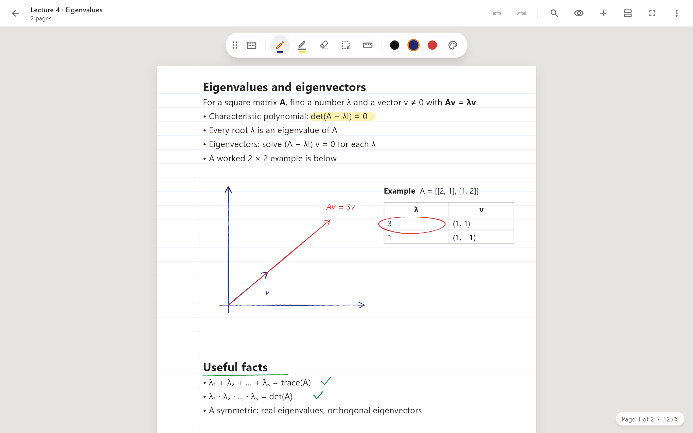
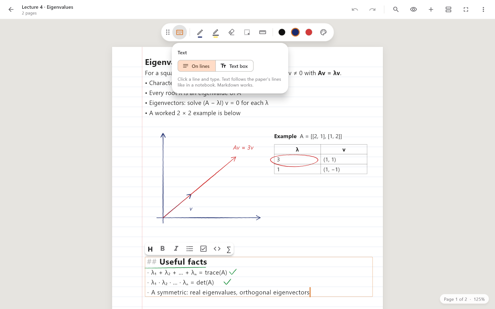
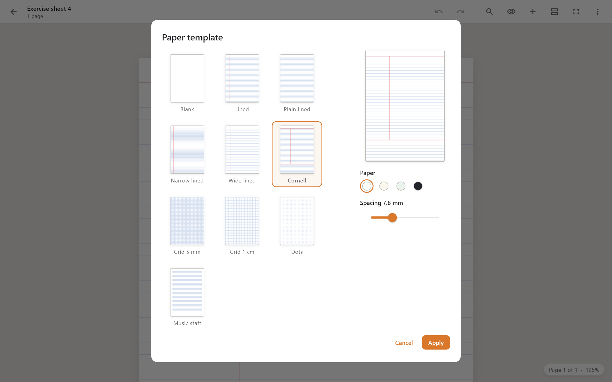
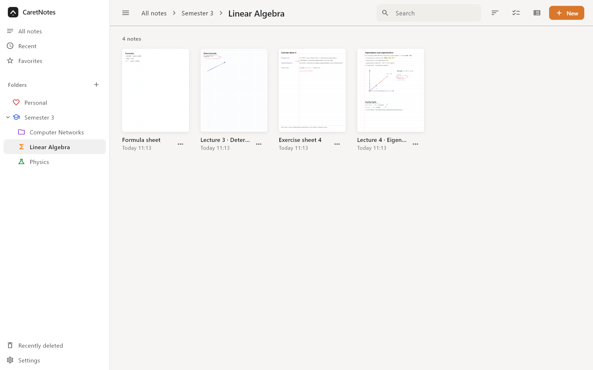
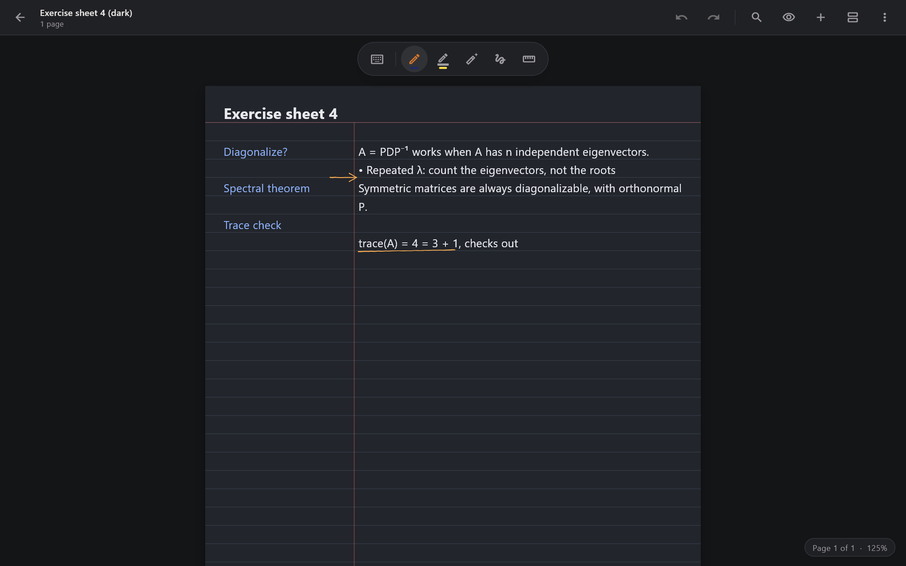

# CaretNotes

**A handwriting-first notes app for pen and touch.** Write with a pressure-sensitive pen, type on the
lines like in a paper notebook, sketch, highlight and drop in your lecture slides. Your notes stay
on your computer as plain files, and sync through the cloud you already use.

  <a href="#get-caretnotes"><b>Get CaretNotes</b></a> ·
  <a href="docs/FEATURES.md">Features</a> ·
  <a href="docs/SYNC.md">Sync setup</a> ·
  <a href="docs/SHORTCUTS.md">Shortcuts</a> ·
  <a href="#documentation">Documentation</a>

Built with Flutter, inspired by Samsung Notes. Windows first; Android comes later from the same code.

## Get CaretNotes

Download the latest version from [Releases](https://github.com/Sooeeren/CaretNotes/releases/latest):

- **Windows:** `CaretNotes-Setup-<version>.exe` installs it (no admin rights needed) and keeps it updated. Or `CaretNotes-<version>-portable.exe`: one file, nothing to install.
- **Linux:** `.deb` (Debian, Ubuntu, Mint), `.rpm` (Fedora, openSUSE), `.pkg.tar.zst` (Arch, Manjaro) or the `.AppImage` for any other distro.
- **Android:** `CaretNotes-<version>.apk`. Allow installing from unknown sources, then open it.

CaretNotes checks for new versions when it starts (Settings → Updates turns that off, or checks by hand).

Or build it yourself with Flutter: see [docs/BUILDING.md](docs/BUILDING.md).

| Platform | Status |
| --- | --- |
| Windows 10 / 11 | Works today; made for pen laptops and tablets (Surface, Galaxy Book, any Windows Ink pen) |
| Linux | Builds from the same code (GTK 3, x86-64); packages for the major distros |
| Android | Early preview: builds from the same code, not yet tuned for phones and tablets |

## How is CaretNotes different?

- **Pen first, keyboard welcome.** Ink is the main thing, with low lag, pressure and palm rejection.
  When you'd rather type, the text sits on the paper's lines instead of floating in boxes.
- **Your files, your cloud.** Every note is a single `.cnote` file in a normal folder. Sync goes
  through Proton Drive, OneDrive or Dropbox (their desktop folder), Google Drive or WebDAV
  (Nextcloud). There is no CaretNotes account or server.
- **Never loses a note.** Saving is atomic, sync never deletes anything for good, and when a note
  changed on two devices you choose: combine both, keep one, or keep both.
- **Open source** under the MIT license.

## Highlights

- **Ink that feels right:** pressure-sensitive pen, fineliner and pencil; a highlighter that stays
  behind your writing; whole-stroke and partial eraser; S Pen side button; palm rejection.
- **Hold to straighten:** pause at the end of a line and it snaps straight. Rough rectangles,
  circles, triangles and arrows become clean shapes.
- **Ruler** you move and rotate with two fingers; lines drawn along it stick to it.
- **Type on the lines** or in free text boxes, with live Markdown: headings, bold, lists, checkboxes,
  code, tables and LaTeX math.
- **Paper for every class:** lined, Cornell, grid, dots, music staff and more, in four paper colors.
- **Pages, an endless page, or an infinite canvas.**
- **PDF lecture slides:** import them, write on them, export again with vector ink and real text.
- **Images:** paste, drag in, crop, rotate, put behind the ink.
- **Library:** nested folders with colors and icons, favorites, search, and Recently deleted (30 days).

## Typing on the lines

Pick the text tool and click a line. Your text follows the ruling of the paper, so typed notes and
handwriting share the same lines. Tap the text tool again to switch to free text boxes, for a
label next to a sketch or a table.

## Paper templates

**⋮ → Paper template…** shows a live preview of every paper. Set it for the whole note or just one
page, pick the paper color and fine-tune the line spacing. Text you typed on the lines moves along.

## Library

Folders nest as deep as you like and get their own color and icon. Every note shows a thumbnail of
its first page. Search finds titles and typed text, and anything you delete stays in Recently
deleted for 30 days.

## Looks

A calm "paper and ink" design with one accent color, in light and dark. Dark paper keeps ink
readable at night.

## Sync

Sync runs when CaretNotes starts, every 3 minutes, when you close a note and when you press
**Sync now**. You can always write offline. Supported:

| Service | How |
| --- | --- |
| Proton Drive, OneDrive, Dropbox | Through the provider's synced folder on your PC |
| Google Drive | Directly, with your own free sign-in client (5 minutes to set up) |
| WebDAV (Nextcloud, ownCloud, NAS) | Directly; the password is stored encrypted |

Setup for each, and how conflicts are handled: [docs/SYNC.md](docs/SYNC.md).

## Documentation

| | |
| --- | --- |
| [Features in detail](docs/FEATURES.md) | Pens, selection, typing, paper, layouts, PDFs, export, where notes are stored |
| [Sync setup](docs/SYNC.md) | Proton Drive / OneDrive / Dropbox, Google Drive, WebDAV; conflicts |
| [Keyboard shortcuts](docs/SHORTCUTS.md) | Editor shortcuts and Markdown while typing |
| [Building](docs/BUILDING.md) | Toolchain, building, tests, demo profiles, screenshots |
| [Design spec](docs/superpowers/specs/2026-11-08-caretnotes-design.md) | What the app must do and why |

## Made with AI

CaretNotes is written with AI coding assistants, steered and tested by its maintainer. Working on
CaretNotes with an AI assistant? Start with [AGENTS.md](AGENTS.md): it explains the project, its
priorities and its conventions.

## License

MIT, see [LICENSE](LICENSE).
